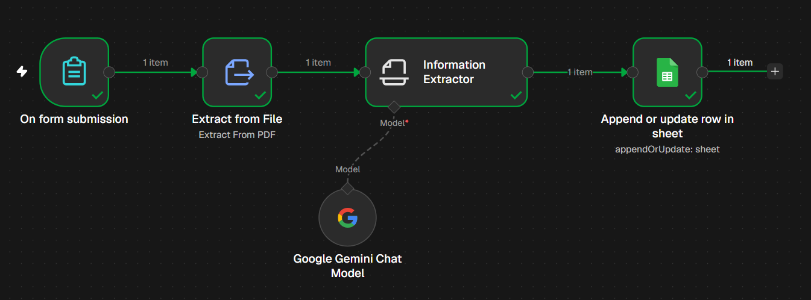
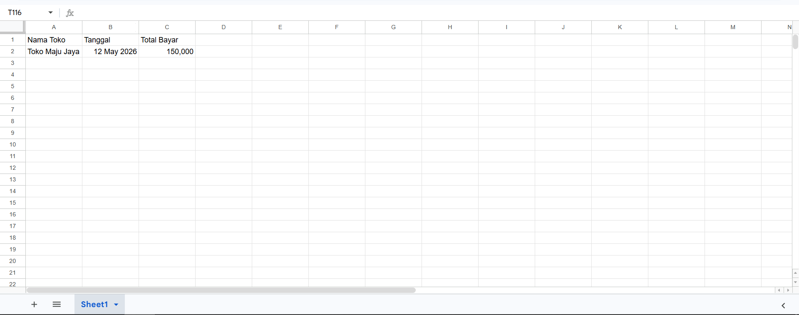

# Otomasi Ekstraksi Data Nota dengan AI & n8n

Proyek ini mengotomasi proses pencatatan nota/invoice PDF ke dalam Google Sheets menggunakan **n8n** dan **Google Gemini AI**. Solusi ini dirancang untuk memangkas waktu input data manual pada proses administrasi keuangan.

## Masalah Bisnis & Solusi
* **Proses Manual (Sebelum):** Staf administrasi membuka file PDF nota satu per satu dan mengetik ulang Nama Toko, Tanggal, serta Total Bayar ke spreadsheet (memakan waktu 2-3 menit per dokumen dan rawan salah ketik).
* **Proses Otomatis (Sesudah):** Pengguna cukup mengunggah file PDF melalui formulir, lalu AI mengekstrak data penting dan mengisi baris baru di Google Sheets secara otomatis dalam waktu kurang dari 10 detik.

## Arsitektur Workflow (n8n)

1. **n8n Form Trigger:** Menerima unggahan file PDF nota dari pengguna.
2. **Extract from File:** Mengubah dokumen PDF menjadi teks mentah.
3. **Information Extractor (Gemini AI):** Mengekstrak atribut `nama_toko`, `tanggal`, dan `total_bayar` secara terstruktur.
4. **Google Sheets:** Menyimpan hasil ekstraksi langsung ke baris baru di spreadsheet.

## Hasil Pencatatan Otomatis

## Cara Mencoba Workflow Ini
1. Unduh file `otomasi-nota.json` dari repositori ini.
2. Buka kanvas n8n Anda, klik menu titik tiga (`...`) di pojok kanan atas, lalu pilih **Import from File**.
3. Masukkan kredensial API Key Google Gemini dan hubungkan akun Google Sheets Anda.
